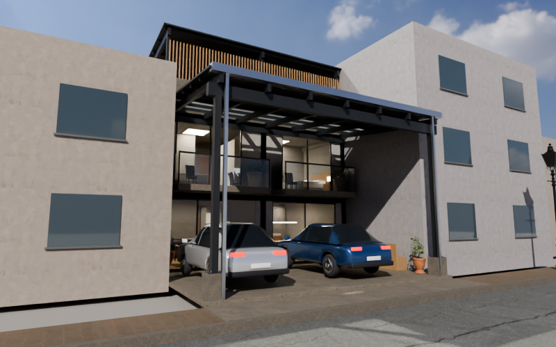

# CASA LINTERNA · Vivienda unifamiliar en lote de 8.00 × 17.00 m

Proyecto de arquitectura (anteproyecto / proyecto básico) — **versión 5**. Frente de 8.00 m a la calle:

| Zona | Medidas | Área | Sistema |
|---|---|---|---|
| Cochera / reuniones (al frente, junto a la calle) | 8.00 × 5.00 m | 40.00 m² | Sin muros. Cobertura metálica a una sola agua (cae hacia la calle) sobre 2 columnas con pedestales |
| Vivienda (material noble) | 8.00 × 12.00 m | 95.50 m² techados por piso, 2 pisos | Albañilería confinada + pórticos de C°A°; solo 2 ductos de 0.50 × 0.50 m en las esquinas posteriores |
| Terraza (3er nivel) | 8.00 × 12.00 m | 96.00 m² | Cobertura metálica liviana a una sola agua |




## Entregables

| Archivo | Contenido | Se abre con |
|---|---|---|
| `entregables/CasaLinterna_Planos_A1.pdf` | 8 láminas A1 vectoriales (plantas de 1er piso, 2do piso y terraza, techos, estructura de coberturas, detalles de pedestal y de apoyo, 2 cortes longitudinales, 2 transversales, elevaciones principal y posterior, vistas 3D, cuadros de vanos, ambientes, áreas y metálicos) | Cualquier visor PDF / plotter |
| `entregables/CasaLinterna_Planos.dxf` | Mismo juego de planos para CAD: espacio modelo a escala real (m) + 8 layouts A1 con viewports 1/50, 1/75 y 1/20, capas normalizadas, bloques con atributos y cotas nativas | AutoCAD, BricsCAD, ZWCAD, DraftSight |
| `entregables/CasaLinterna_Modelo.ifc` | Modelo BIM IFC4: elementos con geometría validada (muros, losas, columnas, vigas, pedestales, escaleras, puertas, ventanas, coberturas, estructura metálica, celosías, mobiliario) + espacios con áreas y Psets | Revit, ArchiCAD, Tekla, BIMcollab, BlenderBIM |
| `entregables/visor-3d.html` | Visor 3D interactivo: pisos, coberturas, capas, **corte en vivo**, selección de elementos con datos BIM y las 8 láminas | Navegador |
| `entregables/laminas/A-0x.png` | Láminas en imagen (150 dpi) | — |
| `entregables/renders/foto-*.png` | Renders fotorrealistas (Cycles) | — |
| `blender/CasaLinterna.blend` | Escena de Blender con materiales, muebles, luces y 7 cámaras | Blender 5.2+ |
| `revit/crear_modelo_revit.py` + `revit/casa_linterna_revit.json` | Script que **construye el modelo nativo en Revit** (ver abajo) | pyRevit, RevitPythonShell, Dynamo |

### Sobre el archivo nativo de Revit (.rvt)

El formato `.rvt` es binario y propietario: solo Revit puede escribirlo, y Revit no corre en el
entorno donde se generó este proyecto. Hay dos caminos para tenerlo, ambos en un par de minutos:

1. **Modelo nativo editable (recomendado).** Abre Revit 2022 o superior con la plantilla métrica de
   arquitectura y ejecuta `revit/crear_modelo_revit.py` con pyRevit o RevitPythonShell (el `.json`
   debe estar en la misma carpeta). El script crea niveles, ejes, tipos de muro/losa/techo con el
   espesor exacto, muros nativos, puertas y ventanas como **tipos paramétricos** duplicados por medida
   (P-01 0.80×2.10, MP-03 2.60×2.40, …), losas con hueco de escalera, balcones, escaleras en U nativas
   (`StairsEditScope`), la cobertura como techo por extrusión, habitaciones con nombre y acabado,
   plantas, cortes, vista 3D y láminas. Columnas, vigas, estructura metálica, celosías, mobiliario y autos
   se crean como `DirectShape` con su categoría BIM y material, para no depender de familias cargadas.
   Luego: **Archivo › Guardar como › CasaLinterna.rvt**.
   El script se escribió contra la API pública de Revit pero **no pudo ejecutarse aquí**; cada bloque
   reporta en consola lo que crea u omite.
2. **Vía IFC.** En Revit: **Archivo › Abrir › IFC** › `CasaLinterna_Modelo.ifc` › Guardar como `.rvt`.
   Es inmediato, pero Revit importa los elementos como geometría IFC (menos editable que la opción 1).

Si usas un servidor **MCP para Revit** que ejecute Python, puedes enviarle el mismo script; si tu
servidor solo ejecuta C#, usa la opción 2 o pyRevit.

## Concepto y programa

El lote tiene 8 m de frente y 17 m de fondo. Los primeros 5 m son la **cochera**: queda abierta, sin
muros, bajo una cobertura metálica a una sola agua (10 %, cae hacia la calle) sobre 2 columnas junto a
la vereda y apoyada en la fachada. Caben 2 autos lado a lado con un pasillo central hacia la puerta; sin
los autos funciona como zona de reuniones.

La vivienda ocupa **los 8 × 12 m completos**. El único espacio libre son **2 ductos de luz y ventilación
de 0.50 × 0.50 m** en las esquinas posteriores (0.50 m² en total): a ellos dan ventanas altas del
dormitorio 1, la cocina y los dormitorios 4 y 5; arriba los cubre una banda de policarbonato. Los baños
interiores llevan extractor mecánico.

**1er piso · NPT ±0.00** — Sala (17.51 m²) y comedor (17.98) abiertos a la cochera con mamparas
corredizas, hall con escalera en U, barra de desayuno, baño de visitas (2.10), **cocina abierta con isla
(17.07)** y **dormitorio 1 (13.02 m²) con baño propio (3.23)**.

**2do piso · NPT +2.80** — **4 dormitorios amplios, cada uno con su baño**, alrededor de un hall-estar:

| Ambiente | Área | Baño | Ancho | Luz y ventilación |
|---|---|---|---|---|
| Dormitorio 2 | 13.91 m² + balcón 3.58 | 3.23 m² | 3.73 m | Mampara y balcón a la cochera |
| Dormitorio 3 | 14.38 m² + balcón 3.63 | 3.23 m² | 3.83 m | Mampara y balcón a la cochera |
| Dormitorio 4 | 13.02 m² | 3.23 m² | 3.73 m | Ventanas altas al ducto |
| Dormitorio 5 | 13.47 m² | 3.23 m² | 3.83 m | Ventanas altas al ducto |

Cada dormitorio tiene cama de 1.35 × 1.90 con veladores, closet y escritorio. Con el del 1er piso son
**5 dormitorios con baño propio**.

**Terraza · NPT +5.60** — 84 m² útiles bajo cobertura (pendiente 5 % hacia el fondo), con parrilla,
lavandería, tendal, comedor y sala exterior, y celosía de madera hacia la calle.

| Cuadro de áreas | m² |
|---|---|
| Terreno | 136.00 |
| Techado 1er piso | 95.50 |
| Techado 2do piso | 95.50 (+ 7.21 de balcones) |
| **Total material noble** | **198.21** |
| Terraza con cobertura liviana | 96.00 |
| Cochera con cobertura liviana | 40.00 (29.4 %) |
| Ductos de luz y ventilación | 0.50 (0.4 %) |

> Nota normativa: el RNE pide que los dormitorios ventilen e iluminen a exteriores o a pozos de luz de
> dimensiones mínimas. Con ductos de 0.50 × 0.50 m, los dormitorios 1, 4 y 5 quedan por debajo de ese
> mínimo; verifica con tu municipalidad o amplía esos ductos si te lo exigen.

## Renders fotorrealistas (Blender + Cycles)

`src/blender_render.py` arma la escena con **Blender 5.2 (bpy) y el motor de trazado de rayos Cycles**
desde el mismo modelo:

- Materiales PBR con texturas CC0 de [Poly Haven](https://polyhaven.com): yeso pintado, concreto,
  porcelanato, piso laminado, cuarzo, madera, calamina TR4 y asfalto, proyectadas en caja sobre la geometría.
- Muebles reales (Poly Haven): sofá, sillones, mesa de centro, sillas de comedor, banquetas y plantas, ubicados y
  orientados automáticamente según el mobiliario del modelo.
- Autos modelados paramétricamente: carrocería con secciones redondeadas, cabina con parantes, pasos de
  rueda, neumáticos, aros de 5 rayos, faros, stops y placas; pintura metalizada con barniz.
- Cielo HDRI + sol, luces interiores, calle, veredas, sardineles y edificios vecinos para dar escala.
- Desruido OpenImageDenoise. Se guarda también `blender/CasaLinterna.blend` para abrir y seguir renderizando.

```
pip install bpy==5.2.3
python3 src/polyhaven.py            # descarga texturas, modelos y HDRI a blender/assets/
python3 src/blender_render.py --samples 128 --res 1600x1000 --blend
```

## Cómo se construyó (flujo paramétrico)

Todo sale de un único modelo paramétrico en Python (`src/model.py`): cada elemento es un prisma
(polígono YZ extruido en X; x = ancho, y = fondo) con categoría BIM, material, nivel y fase. De esa fuente única se generan:

- `views.py` — plantas, cortes y elevaciones con **eliminación real de líneas ocultas** (geometría
  booleana con shapely), poché por material y anotaciones.
- `drawing.py` — bloques paramétricos (puertas, ventanas, sanitarios, mobiliario) que en DXF se
  escriben como bloques reutilizables por medida con atributos `CODIGO/ANCHO/ALTO`.
- `sheets.py` / `dxf_export.py` — maquetación A1, rótulo, cuadros y exportación PDF/DXF.
- `ifc_export.py` — IFC4 con estilos, materiales, Psets y espacios.
- `revit_export.py` + `revit/crear_modelo_revit.py` — datos semánticos y automatización de Revit.

Cambiar una medida en `model.py` y ejecutar `python3 src/build_all.py` regenera todos los entregables
de forma coherente. Nota: los bloques DXF son bloques estándar con atributos (uno por medida); ezdxf no
puede escribir bloques dinámicos de AutoCAD con parámetros/acciones.

Requisitos para regenerar: `pip install ezdxf ifcopenshell matplotlib shapely pillow` y Node con
Playwright (solo para los renders).

---
*Propietario, ubicación y proyectista quedan en blanco en el rótulo para completarse.*
