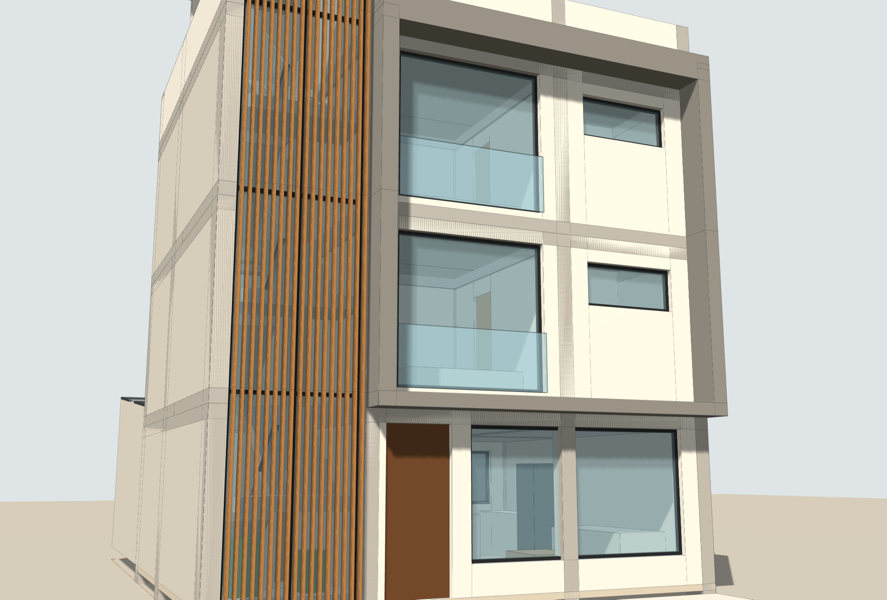

# CASA LINTERNA · Vivienda unifamiliar en lote de 8.00 × 12.00 m

Proyecto de arquitectura a nivel de **anteproyecto/proyecto básico** para una vivienda de 2 pisos con
proyección a 3er piso, sobre un lote de 96.00 m²:

| Zona | Medidas | Área | Sistema |
|---|---|---|---|
| Edificación (material noble) | 8.00 × 7.00 m | 56.00 m² por piso | Albañilería confinada + pórticos de C°A° |
| Área libre (frente al fondo del lote) | 8.00 × 5.00 m | 40.00 m² (41.7 %) | Cobertura metálica liviana |

## Entregables

| Archivo | Contenido | Se abre con |
|---|---|---|
| `entregables/CasaLinterna_Planos_A1.pdf` | 6 láminas A1 vectoriales (plantas, techos, 4 cortes, 2 elevaciones, estructura de cobertura, 2 detalles 1/10, vistas 3D, cuadros de vanos, ambientes, áreas y metálicos) | Cualquier visor PDF / plotter |
| `entregables/CasaLinterna_Planos.dxf` | Mismo juego de planos para CAD: espacio modelo a escala real (m) + 6 layouts A1 con viewports 1/50 y 1/10, capas normalizadas, bloques con atributos y cotas nativas | AutoCAD, BricsCAD, ZWCAD, DraftSight |
| `entregables/CasaLinterna_Modelo.ifc` | Modelo BIM IFC4: 271 elementos (muros, losas, columnas, vigas, escaleras, puertas, ventanas, cobertura, estructura metálica, celosías, mobiliario) + 26 espacios con áreas y Psets | Revit, ArchiCAD, Tekla, BIMcollab, BlenderBIM |
| `entregables/visor-3d.html` | Visor 3D interactivo: pisos, fase 2, capas, **corte en vivo**, selección de elementos con datos BIM y las 6 láminas | Navegador |
| `entregables/laminas/A-0x.png` | Láminas en imagen (150 dpi) | — |
| `entregables/renders/*.png` | Vistas 3D | — |
| `revit/crear_modelo_revit.py` + `revit/casa_linterna_revit.json` | Script que **construye el modelo nativo en Revit** (ver abajo) | pyRevit, RevitPythonShell, Dynamo |

### Sobre el archivo nativo de Revit (.rvt)

El formato `.rvt` es binario y propietario: solo Revit puede escribirlo, y Revit no corre en el
entorno donde se generó este proyecto. Hay dos caminos para tenerlo, ambos en un par de minutos:

1. **Modelo nativo editable (recomendado).** Abre Revit 2022 o superior con la plantilla métrica de
   arquitectura y ejecuta `revit/crear_modelo_revit.py` con pyRevit o RevitPythonShell (el `.json`
   debe estar en la misma carpeta). El script crea niveles, ejes, tipos de muro/losa/techo con el
   espesor exacto, muros nativos, puertas y ventanas como **tipos paramétricos** duplicados por medida
   (P-01 0.80×2.10, V-04 2.40×2.30, …), losas con hueco de escalera, escaleras en U nativas
   (`StairsEditScope`), la cobertura como techo por extrusión, habitaciones con nombre y acabado,
   plantas, cortes, vista 3D y láminas. Columnas, vigas, estructura metálica, celosías y marco volado
   se crean como `DirectShape` con su categoría BIM y material, para no depender de familias cargadas.
   Luego: **Archivo › Guardar como › CasaLinterna.rvt**.
   El script se escribió contra la API pública de Revit pero **no pudo ejecutarse aquí**; cada bloque
   reporta en consola lo que crea u omite.
2. **Vía IFC.** En Revit: **Archivo › Abrir › IFC** › `CasaLinterna_Modelo.ifc` › Guardar como `.rvt`.
   Es inmediato, pero Revit importa los elementos como geometría IFC (menos editable que la opción 1).

Si usas un servidor **MCP para Revit** que ejecute Python, puedes enviarle el mismo script; si tu
servidor solo ejecuta C#, usa la opción 2 o pyRevit.

## Concepto

**La linterna.** La escalera en U se ubica contra la medianera izquierda, detrás de un muro cortina de
vidrio de triple altura protegido por una celosía vertical de listones (aluminio acabado madera). De día
ilumina el núcleo de circulación con luz filtrada; de noche la casa se lee desde la calle como un farol.
La caseta de azotea remata la linterna con un lucernario de vidrio laminado sobre la escalera. Bajo el
primer descanso, visible desde la vereda, hay un pequeño jardín interior de canto rodado.

**El marco.** Los pisos 2 y 3 quedan enmarcados por un pórtico volado de concreto caravista (0.50 m)
que da sombra a los ventanales piso-techo con baranda de vidrio y funciona como alero del ingreso.

**El patio techado.** El área libre se cubre con una cobertura liviana que **sube hacia el fondo** (10 %):
la casa “abre” el patio hacia el cielo y el agua escurre a una canaleta junto al edificio, lejos de los
vecinos. Una franja de policarbonato alveolar de 1.20 m deja pasar luz cenital y una celosía metálica
perforada sobre el cerco posterior asegura la ventilación cruzada. El programa del patio: terraza-comedor
exterior, barra de parrilla con campana y chimenea, lavandería-tendal tras una celosía de listones y una
jardinera con jardín vertical.

## Programa arquitectónico

**1er piso · NPT ±0.00** — Sala (19.89 m²) con ingreso directo, comedor (7.29) y cocina con isla (7.43)
integrados y abiertos a la terraza por una mampara corrediza de 2.60 m, hall (3.80), baño de visitas
completo (2.85), depósito bajo escalera y jardín interior. Área libre de 40.00 m².

**2do piso · NPT +2.80** — 2 suites, cada dormitorio con **baño propio**:
- Dormitorio 1 (10.95 m², ventanal a la calle) → walk-in closet (3.91) → baño 1 (4.14)
- Dormitorio 2 (9.99 m², vista al patio) → baño 2 (4.32) + walk-in (2.85)
- Estar/hall (3.99)

**3er piso · NPT +5.60 (proyección, Fase 2)** — Repite la planta típica: dormitorios 3 y 4 con baños 3 y 4.

**Azotea · NPT +8.40** — Caseta de escalera con lucernario, tanque elevado de 1100 L, sumideros.

| Cuadro de áreas | m² |
|---|---|
| Terreno | 96.00 |
| Techado 1er piso | 56.00 |
| Techado 2do piso | 56.00 |
| **Subtotal Fase 1** | **112.00** |
| Techado 3er piso (proyección) | 56.00 |
| Caseta de escalera (proyección) | 12.08 |
| **Total techado (Fase 1 + 2)** | **180.08** |
| Área libre (cobertura liviana) | 40.00 (41.7 %) |

## Criterios técnicos

- **Estructura (referencial):** columnas C-1 0.25×0.40 (perimetrales) y C-2 0.25×0.25, vigas 0.25×0.40,
  losa aligerada h = 0.20, cimientos corridos y zapatas. Ejes 1-2-3-4 (luces 2.10 / 3.15 / 2.50 m) y
  A-B-C (3.85 / 2.90 m). Columnas y cimentación pensadas para 3 niveles desde la Fase 1.
  **Debe ser diseñada y firmada por un ingeniero civil colegiado** (E.030, E.060, E.070, E.090).
- **Escalera:** 16 contrapasos de 0.175 m, pasos de 0.25 m, ancho libre 0.90 m por tramo, descanso de 1.00 m.
- **Cobertura metálica:** paneles termoacústicos TR4 e = 50 mm + policarbonato alveolar 10 mm; vigas VM-1
  tubo 100×200×3 @ 1.45 m; correas CO-1 tubo 50×100×2 @ 0.95 m; viga posterior VM-2 tubo 150×300×4 sobre
  2 columnas CM-1 tubo 150×150×4; apoyo en el edificio con ángulo L100×100×6 y pernos expansivos Ø5/8" @ 0.60
  sobre la viga VS-C; arriostres en cruz con varilla Ø1/2"; canaleta galvanizada y 2 bajantes de 3".
  Ver detalles 1 y 2 (lámina A-04).
- **Normativa de referencia (Perú, RNE):** A.010, A.020, E.030, E.060, E.070, E.090, IS.010. Verifica los
  parámetros urbanísticos de tu municipalidad (altura máxima, retiros, porcentaje de área libre y si la
  cobertura liviana del área libre requiere trámite).

## Cómo se construyó (flujo paramétrico)

Todo sale de un único modelo paramétrico en Python (`src/model.py`): cada elemento es un prisma
(polígono YZ extruido en X) con categoría BIM, material, nivel y fase. De esa fuente única se generan:

- `views.py` — plantas, cortes y elevaciones con **eliminación real de líneas ocultas** (geometría
  booleana con shapely), poché por material y anotaciones.
- `drawing.py` — bloques paramétricos (puertas, ventanas, sanitarios, mobiliario) que en DXF se
  escriben como bloques reutilizables por medida con atributos `CODIGO/ANCHO/ALTO`.
- `sheets.py` / `dxf_export.py` — maquetación A1, rótulo, cuadros y exportación PDF/DXF.
- `ifc_export.py` — IFC4 con estilos, materiales, Psets y espacios.
- `revit_export.py` + `revit/crear_modelo_revit.py` — datos semánticos y automatización de Revit.

Cambiar una medida en `model.py` y ejecutar `python3 src/build_all.py` regenera todos los entregables
de forma coherente. Nota: los bloques DXF son bloques estándar con atributos (uno por medida); ezdxf no
puede escribir bloques dinámicos de AutoCAD con parámetros/acciones.

Requisitos para regenerar: `pip install ezdxf ifcopenshell matplotlib shapely pillow` y Node con
Playwright (solo para los renders).

---
*Propietario, ubicación y proyectista quedan en blanco en el rótulo para completarse.*
