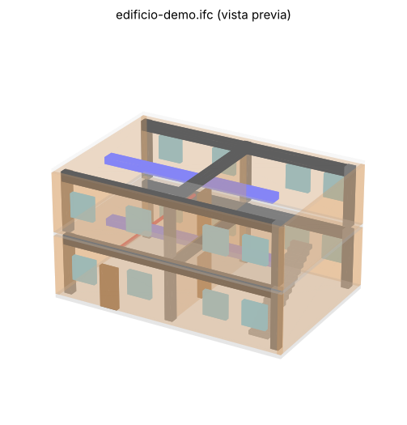

# Demo de nwd-mcp con Navisworks Manage 2027

Proyecto de ejemplo para ver cómo trabaja [nwd-mcp](https://github.com/bimwright/nwd-mcp), el servidor MCP que permite a Claude (o a cualquier cliente MCP) leer y controlar **Autodesk Navisworks Manage**.

Todo se ejecuta desde **PowerShell**. Los scripts hablan con el servidor MCP igual que lo haría Claude (JSON-RPC por stdin/stdout), así ves exactamente qué pide cada herramienta y qué devuelve.

```
Claude / PowerShell  ──JSON-RPC (stdio)──►  nwd-mcp.exe  ──TCP local──►  Plugin dentro de Navisworks 2027
```

## Contenido

| Archivo | Qué hace | ¿Cambia algo en Navisworks? |
|---|---|---|
| `00-instalar-2027.ps1` | Descarga, corrige, compila e instala el plugin 2027 y el servidor | Instala el plugin (con Navisworks **cerrado**) |
| `01-diagnostico.ps1` | Comprueba la instalación y la conexión, y muestra datos del documento | No |
| `02-explorar-modelo.ps1` | Árbol del modelo, búsqueda, propiedades (CSV), vistas y conjuntos | No (modo `--read-only`) |
| `03-interactuar.ps1` | Selecciona, oculta y vuelve a mostrar elementos; guarda vistas | Sí: la vista y la selección. No guarda el archivo |
| `04-script-csharp.ps1` | Ejecuta código C# dentro de Navisworks (`nwd_send_code`) | No (los ejemplos solo leen) |
| `demo-completa.ps1` | Ejecuta todo y genera un informe HTML | Solo si usas `-Interactuar` |
| `NwdMcpCliente.psm1` | Cliente MCP reutilizable en PowerShell | — |
| `PROMPTS-CLAUDE.md` | Ejemplos de cosas que pedirle a Claude | — |

## Uso rápido

1. Descarga esta carpeta en tu PC, por ejemplo en `C:\Users\Denis\nwd-mcp-demo`.
2. Abre PowerShell en esa carpeta.

**Instalación** (solo la primera vez, con Navisworks cerrado). Si ya compilaste e instalaste el plugin a mano, sáltatela.

```powershell
powershell -ExecutionPolicy Bypass -File .\00-instalar-2027.ps1
```

**Abre Navisworks Manage 2027 y carga un modelo**, y luego:

```powershell
powershell -ExecutionPolicy Bypass -File .\01-diagnostico.ps1
```

```powershell
powershell -ExecutionPolicy Bypass -File .\02-explorar-modelo.ps1 -Buscar "Muro"
```

```powershell
powershell -ExecutionPolicy Bypass -File .\03-interactuar.ps1 -Buscar "Muro"
```

```powershell
powershell -ExecutionPolicy Bypass -File .\04-script-csharp.ps1
```

O todo de una vez, con informe HTML:

```powershell
powershell -ExecutionPolicy Bypass -File .\demo-completa.ps1 -Buscar "Muro" -Interactuar
```

Cambia `"Muro"` por cualquier texto que aparezca en los nombres de los elementos de tu modelo (`Wall`, `Puerta`, `Pipe`, `Level 1`...). Los resultados quedan en la carpeta `salida\`:

- `02-arbol-modelo.csv`, `02-propiedades.csv`: se abren en Excel (separador `;`)
- `informe.html`: resumen visual
- archivos `.json`: respuesta exacta del MCP en cada paso

## Modelo de prueba

`modelo/edificio-demo.ifc` es un edificio de 2 niveles + cubierta (12 x 8 m) con 72 elementos: losas, muros, columnas, vigas, puertas, ventanas, escalera, ductos y tuberías. Todos tienen nombres en español y propiedades (`Pset_*Common` y `Datos_Demo`: Disciplina, Código, Material, Nivel, Costo_CLP...).



Ábrelo en Navisworks con **Abrir → Tipo: IFC (*.ifc)** y prueba, por ejemplo:

```powershell
powershell -ExecutionPolicy Bypass -File .\demo-completa.ps1 -Buscar "Columna" -Interactuar
```

Trae un **choque intencional**: la `Tubería aguas lluvia 01` atraviesa las vigas del Nivel 1, útil para probar Clash Detective (Sanitaria contra Estructura). Para regenerarlo: `pip install ifcopenshell numpy` y luego `python modelo\generar_modelo.py`.

## Usar el cliente en tus propios scripts

```powershell
Import-Module .\NwdMcpCliente.psm1
Start-NwdMcp -Target 2027

$r = Invoke-NwdTool nwd_find_items_by_name @{ name = "Puerta"; max_items = 100 }
$ids = (Get-NwdData $r).item_ids

Invoke-NwdTool nwd_batch_get_properties @{ item_ids = $ids; max_items = 100 }
Invoke-NwdTool nwd_send_code @{ code = 'doc.Models.Count' }

Stop-NwdMcp
```

## Herramientas disponibles (33)

- **Conexión:** `nwd_health_check`, `nwd_list_available_targets`, `nwd_get_current_target`, `nwd_switch_target`
- **Archivos:** `nwd_list_recent_files`, `nwd_open_file`, `nwd_import_model`
- **Consulta:** `nwd_get_document_info`, `nwd_get_model_statistics`, `nwd_get_model_tree`, `nwd_get_item_properties`, `nwd_batch_get_properties`, `nwd_find_items`, `nwd_find_items_by_name`
- **Selección:** `nwd_get_current_selection`, `nwd_clear_selection`, `nwd_select_items_by_search`
- **Conjuntos:** `nwd_list_sets`, `nwd_get_selection_set_items`, `nwd_execute_search_set`
- **Vistas:** `nwd_list_viewpoints`, `nwd_get_current_viewpoint`, `nwd_goto_viewpoint`, `nwd_save_viewpoint`
- **Visibilidad:** `nwd_hide_items`, `nwd_unhide_all`
- **Código:** `nwd_send_code` (C# dentro de Navisworks)
- **ToolBaker:** `nwd_list_baked_tools`, `nwd_run_baked_tool`, `nwd_list_bake_suggestions`, `nwd_accept_bake_suggestion`, `nwd_dismiss_bake_suggestion`, `nwd_create_bake_issue_draft`

## Problemas frecuentes

| Síntoma | Solución |
|---|---|
| `host_connected = False` | Navisworks no está abierto o no aparece la pestaña **Bimwright**. Vuelve a ejecutar `00-instalar-2027.ps1` con Navisworks cerrado. |
| `Sin respuesta ... (timeout)` | Navisworks estaba ocupado (cargando o con un diálogo abierto). Espera y repite. |
| Acentos raros en la consola | Ejecuta `chcp 65001` antes de los scripts. |
| La búsqueda no encuentra nada | Usa un texto que aparezca en el árbol (`salida\02-arbol-modelo.csv`). |
| No se pueden ejecutar scripts | Usa siempre `powershell -ExecutionPolicy Bypass -File ...`. |

## Nota sobre Navisworks 2027

En el repositorio original, el proyecto `src/plugin-navis27` no compila: referencia `Autodesk.Navisworks.Api.Controls.dll`, que no existe (la correcta es `Autodesk.Navisworks.Controls.dll`), y le falta el paquete `IsExternalInit`. `00-instalar-2027.ps1` lo corrige copiando la configuración del proyecto 2025, que es la versión verificada por el autor.
